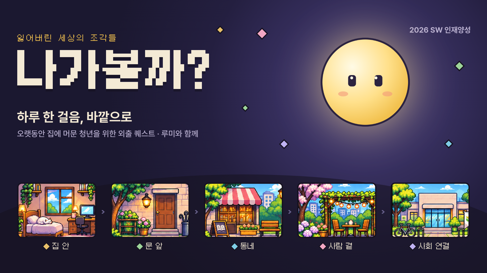

# 나가볼까? 🌙

**오늘은 현관문까지만. 루미와 함께 하루 한 걸음씩 바깥으로 나가요.**

오랫동안 집에 머문 청년을 위한 외출 퀘스트 서비스

<br/>

[](https://nagabolkka.vercel.app/)

[](https://github.com/nagabolkka/nagabolkka-fe)
[](https://github.com/nagabolkka/nagabolkka-be)
[](https://github.com/nagabolkka/nagabolkka-ai)

</div>

---

```
🌕  "오늘의 퀘스트야. 현관문 열고 햇빛 10분 쬐기."
🧑  "...오늘은 좀 어려울 것 같아."
🌕  "그럼 작게 쪼개 볼까?  ① 신발 신어 보기  ② 현관문 열어 보기  ③ 문 앞에 1분 서 있기"
🧑  "신발까지는 신어 봤어."
🌕  "그것도 한 걸음이야. 문턱 조각을 찾았어 ✨  방문 틈으로 빛이 새어 들어와."
```

작은 퀘스트 하나가 **해내고 → 조각을 모으고 → 색을 되찾고 → 한 칸 더 나아가는** 모험으로 이어집니다.
서두르지 않아도, 오늘 쉬어 가도 괜찮아요. 모은 조각은 줄어들지 않으니까요.

<br/>

## 🚪 문밖까지, 왜 이렇게 멀까요

오래 집에 머문 사람에게 "밖에 좀 나가 봐"는 너무 큰 한 걸음입니다.
어디로 갈지, 가서 무엇을 할지, 누구를 마주칠지가 모두 부담이 되니까요.

그래서 바깥을 **아주 작은 단위**로 나눴습니다.

<table>
<tr><td align="center"><b>창문 열기</b></td><td>집 안에서 할 수 있는 것부터 시작해요</td></tr>
<tr><td align="center"><b>현관 앞</b></td><td>문 밖 1분, 집 앞 골목 한 바퀴</td></tr>
<tr><td align="center"><b>동네</b></td><td>근처 공원 벤치, 도서관에서 책 한 권</td></tr>
<tr><td align="center"><b>사람 곁 · 사회</b></td><td>뒷자리에서 듣기만 하는 프로그램, 그리고 다음 한 걸음</td></tr>
</table>

실패해도 잃는 것은 없고, 해낸 만큼 세상이 밝아지도록요.

> 그래서 질문했습니다.
> **"나가 봐" 대신 "오늘은 여기까지만 가 볼까?" 라고 말해 준다면?**

<br/>

## 🌕 루미가 하는 일

**나가볼까?** 는 색을 잃은 세상을 루미와 함께 되살리는 모험이에요. 현실의 외출 한 번이 모험 속 조각 하나가 돼요.

### 🧭 하루 한 퀘스트

> 📋 **시작 체크** → 🎯 **오늘의 퀘스트** → ✂️ **쪼개기 · 바꾸기 · 쉬기** → 📝 **기분 · 한 줄 회고** → 💎 **조각 · 복원도** → 🗺️ **다음 지역**

시작 체크 8문항으로 지금 있는 계단에서 출발해요. 하루 1개 퀘스트가 지금 있는 곳 근처의 실제 장소와 함께 배정되고, 부담되면 3단계로 쪼개거나 하루 2번까지 바꿀 수 있어요.
기분이 좋았던 날은 다음 퀘스트가 한 단계 어려워지고, 힘들었거나 쉬어 간 날은 한 단계 쉬워져요.

### 🗺️ 바깥과 이어지는 곳

> 📍 **동네 지도** · 🎭 **연습실** · 🎯 **목표 준비** · 📖 **모험 일지** · 💌 **루미의 편지**

내 위치 근처의 공원 · 도서관 · 주민 공간 · 청년 공간을 둘러보고 **다음 퀘스트로 담을** 수 있어요.
연습실에서는 첫 전화 · 첫 방문 · 모의 면접을 AI 상대역과 미리 연습하고, 끝나면 연습한 그대로 해 볼 수 있는 실제 퀘스트를 받아요.
매주 월요일에는 루미가 지난 한 주를 돌아보는 편지를 보내요.

### 🛟 혼자 두지 않아요

> 🆘 **위기 표현 감지** · ☎️ **도움 받기** · 🔒 **마음 기록 보호**

회고와 연습 대화에서 위기 표현이 감지되면 연출 없이 바로 **도움 받기** 화면으로 안내해요. 24시간 상담 번호와 내 위치에서 가장 가까운 정신건강복지센터를 보여 줘요.
기분 · 회고 · 연습 대화 같은 마음 기록은 관리자도 볼 수 없어요.

<br/>

<details>
<summary><b>🪜 다섯 계단, 다섯 개의 세상</b></summary>

<br/>

| 계단 | 모험 속 지역 | 현실 | 모으는 조각 |
|:---:|---|---|---|
| 1 | 💛 시작의 방 | 집 안 | 빛의 조각 |
| 2 | 💚 바람의 숲 | 문 앞 | 바람의 조각 |
| 3 | 💙 발견의 마을 | 동네 | 발견의 조각 |
| 4 | 🩷 만남의 정원 | 사람 곁 | 마음의 조각 |
| 5 | 💜 새로운 세상 | 사회 연결 | 희망의 조각 |

- 지역마다 쉬움 · 보통 · 도전 미션이 있고, **비 오는 날**에만 찾을 수 있는 조각도 있어요
- 퀘스트를 한 번 완료할 때마다 그 지역의 복원도가 20% 올라 색이 돌아와요
- 복원도가 100% 가 되면 다음 지역을 제안해요. **더 머물기**를 골라도 괜찮아요
- 지나온 지역은 "돌아갈 수 있는 곳" 으로 남아 언제든 다시 미션을 받을 수 있어요

</details>

<details>
<summary><b>📍 지금 있는 곳 기준, 하지만 위치는 저장하지 않아요</b></summary>

<br/>

- 날씨는 보낸 위치를 **기상청 격자로 변환**해서 조회해요. 비가 오면 실내 미션과 빗소리 조각이 나와요
- 퀘스트 장소와 동네 지도는 **카카오 로컬**로 지금 위치 근처의 실제 장소를 찾아요. 수락 전에 멀리 이동했다면 새 위치로 다시 찾아요
- 사용자 좌표는 계산에만 쓰고 **저장하지 않아요**. 남는 건 장소 좌표와 위치 이용 사실 (목적 · 시각, 6개월 후 자동 삭제) 뿐이에요
- 위치를 거부해도 앱은 막히지 않아요. 가입할 때 고른 동네 기준으로 계속 쓰고, 켜는 방법만 안내해요

</details>

<details>
<summary><b>🆘 위기 표현은 두 번 확인해요</b></summary>

<br/>

```
📝 회고 · 연습 대화
   │
   ▼
🔎 자체 규칙         예외 표현을 먼저 지우고 → 위기 패턴 / 주의 패턴 검사
   │                 ("자살골", "배고파 죽겠다" 같은 일상 표현은 통과)
   ▼
🤖 OpenAI Moderation  주의 패턴이 있으면 더 낮은 기준으로 판단
   │                 Moderation 이 실패하면 안전 쪽(위기)으로
   ▼
🛟 도움 받기          회고 원문은 저장하지 않고, 감지 시각만 기록
```

- 밖으로 나가는 앱이라 "옥상에서 바람 쐬었다", "한강 걸었다" 같은 문장은 일부러 위기 패턴에서 뺐어요
- 사용자 문장은 프롬프트에서 시스템 지시와 분리된 데이터로만 넣어요

</details>

<details>
<summary><b>🛡️ AI 가 멈춰도 하루 퀘스트는 계속돼요</b></summary>

<br/>

- AI 서버는 외부에 공개하지 않고 백엔드에서만 내부 키로 호출해요
- 루미 한마디 · 연습 대화 · 피드백 · 편지는 OpenAI 가 실패하면 **미리 쓴 템플릿 문장**으로 대신해요
- 기상청이 실패하면 맑음, 카카오 로컬이 실패하면 미션 기본 장소로 이어가요
- AI 를 기다리는 동안 DB 잠금을 잡지 않도록 **위기 검사 → 저장 → AI 한마디** 순서로 나눴어요

</details>

<br/>

## 🧭 오늘의 외출이 조각이 되기까지

```
🎯 퀘스트 배정       현재 계단 · 오늘 난이도 · 최근에 안 한 미션 먼저 · 비 오면 실내 미션
   │
   ▼
📍 근처 장소         카카오 로컬로 지금 위치에서 가까운 공원 · 도서관 · 청년 공간
   │
   ▼
✂️ 쪼개기 · 바꾸기   미션마다 정해진 3단계 · 하루 2번 바꾸기 · 오늘은 쉬어도 OK
   │
   ▼
📝 기록              기분 5단계 + 한 줄 회고 (선택 · 암호화 저장)
   │
   ▼
🆘 위기 검사         자체 규칙 + OpenAI Moderation → 감지되면 바로 도움 받기
   │
   ▼
💎 조각 · 복원도     도감 25칸 · 지역 복원도 +20% · 100% 면 다음 지역 제안
   │
   ▼
🌕 루미 한마디       회고 · 기분에 맞춘 AI 응원 · 실패하면 템플릿
   │
   ▼
💌 루미의 편지       매주 월요일 배치 · 한 주 외출 기록으로 편지 + 다녀온 곳 근처 추천
```

<br/>

## 🔧 Built with

**Frontend**


**Backend**


**AI**


**External API**


**Infra**


**Collaboration**


<br/>

## 🧑‍🚀 Team


|  |
|:---:|
| **홍윤지** |
| Frontend · Backend · AI |
| [@dbszl3](https://github.com/dbszl3) |


---


**오늘은 여기까지만 가 볼까?**

<sub>2026 SW 인재양성 · 다시 바깥이 궁금해질 청년들을 위해</sub>

